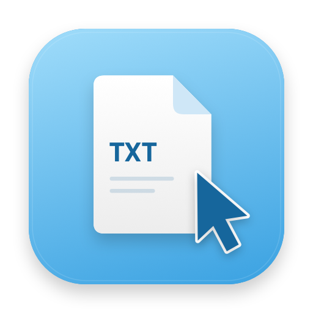

<div align="center">
  
  <h1>右键新文本</h1>
  <p><strong>在 Finder 里，顺手新建一个文本文件。</strong></p>
  <p>A native macOS Finder utility for creating empty text files.</p>
  <p><strong>macOS 13+ · Apple Silicon / Intel</strong> · Swift · MIT</p>
  <p><a href="#功能与边界">功能</a> · <a href="#构建与测试">构建</a> · <a href="CONTRIBUTING.md">参与改进</a> · <a href="#联系与支持">联系与支持</a></p>
</div>

---

我开发了右键新文本，让 Finder 补上一个日常小动作：在当前文件夹创建空白 TXT 文件。应用通过原生扩展与服务接入 Finder，按授权范围创建文件，已有文件不会被覆盖。

> **项目状态**：我于 2026 年 10 月 13 日停止本项目的 App Store 发布计划，并公开源码。当前仓库提供自行构建的方式，尚未发布经过 Developer ID 签名与公证的安装包。

## 功能与边界

- 普通本地目录：Finder 空白处右键创建 TXT，同名自动编号，保留已有文件。
- iCloud Drive：在上一级右键目标文件夹，选择“服务 → 新建txt文本”，然后自行打开文件夹查看和改名。
- 可选 Action Extension 兼容入口。
- 文件创建限定在使用者授权的目录内。
- 本机处理，没有账户、广告、网络请求或第三方 SDK。

**iCloud 文件夹空白处直接菜单的稳定性问题仍未解决。** 当前服务入口是兼容路线，不能宣称所有云盘或 Finder 特殊视图均可用。

## 构建与测试

要求 macOS 13+、完整 Xcode 和 XcodeGen。应用支持 Apple Silicon 和 Intel 编译目标。

```sh
brew install xcodegen
bash scripts/test.sh
xcodegen generate
```

打开生成的 `RightClickText.xcodeproj`，为主应用、两个扩展及 XPC worker 配置自己的签名团队和适用标识。当前 `project.yml`、App Group 和 `Sources/ServiceInterface/CreationServiceProtocol.swift` 保留原始签名约束作为示例；fork 后需要一致替换团队标识与 Bundle ID。这些公开标识不是证书、私钥或有效签名凭据。

`scripts/build.sh` 接收 `SIGNING_IDENTITY`。使用有效的本机签名身份构建：

```sh
SIGNING_IDENTITY="YOUR_SIGNING_IDENTITY" bash scripts/build.sh release
```

`SIGNING_IDENTITY=-` 仅适用于编译检查，不能证明 Finder 扩展、App Group 或 XPC 的实际运行通过。正式站外分发还需要自己的 Developer ID 签名和公证。

## 安装后使用

1. 将自己签名的完整应用放入“应用程序”并打开。
2. 启用 Finder 扩展，添加需要授权的目录。
3. 普通目录使用直接右键菜单；云盘使用目标文件夹的“服务”入口。

无需辅助功能、自动化、完全磁盘访问或管理员权限。系统版本、其他 Finder 扩展及文件提供程序可能影响菜单显示。

## 实现

- `Sources/App`：设置、目录授权、请求消费与生命周期。
- `Sources/Extension`、`Sources/ActionExtension`：Finder 与快速操作入口。
- `Sources/CreationService`、`Sources/ServiceInterface`：独立临时沙盒 worker 和双向签名验证。
- `Sources/Core`：原子创建、真实路径边界及一次性请求队列。
- `Tests/CoreTests`：文件创建和目录策略测试。

## 验证状态

核心测试 29 项通过。主应用、Finder 扩展、Action Extension 与 XPC worker 的 Apple Silicon / Intel 编译检查通过。

本地测试与编译结果不代表商店审核通过。临时签名只用于编译检查；Finder 菜单、App Group 和双向 XPC 校验需要配套签名后实测。

## 参与改进

欢迎提交问题、修复和体验改进。请先查看 [贡献指南](CONTRIBUTING.md)，在 Issues 中注明系统版本、复现步骤及预期行为。安全问题请通过 [安全反馈说明](SECURITY.md) 私下联系我，避免公开敏感信息。

## 许可证

我的原始应用源码按 [MIT 许可证](LICENSE) 开源。项目使用 Apple 系统框架，没有打包第三方运行时依赖。

## 联系与支持

我是宋鑫。如果你在使用或开发中有建议，欢迎通过 GitHub Issues 或 [sapplex@icloud.com](mailto:sapplex@icloud.com) 联系我，也可以扫描下方微信二维码。

如果这个项目对你有帮助，欢迎自愿赞赏，支持我继续做实用的小工具。

<table>
  <tr>
    <th align="center">微信联系</th>
    <th align="center">微信赞赏</th>
  </tr>
  <tr>
    <td align="center"></td>
    <td align="center"></td>
  </tr>
</table>
